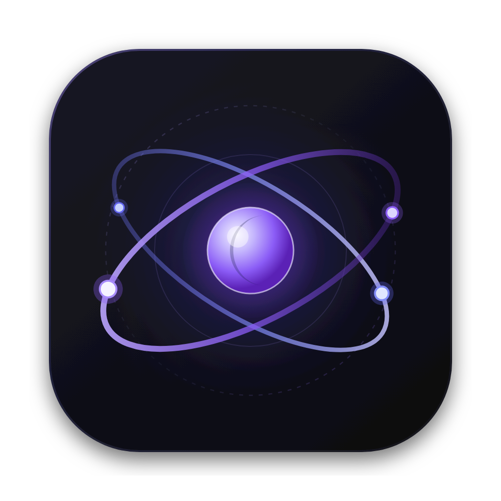

<div align="center">



# ForgeOrbit — Personal AI Company Operating System for macOS

**Your agents. One orbit.**

A local-first macOS (Apple Silicon) desktop application and CLI built with [Electrobun](https://github.com/blackboardsh/electrobun), [Bun](https://bun.sh), and React for orchestrating AI coding agents across multiple projects.

[](#building-from-source)
[](./LICENSE)
[](https://bun.sh)

</div>

---

> [!IMPORTANT]
> **Personal experimental project.** ForgeOrbit is developed for personal daily use on macOS Apple Silicon. There are **no official signed or notarized public releases**, no public DMG installers, no automatic update distribution, and no commercial support guarantees. Source code is published as-is for inspection, experimentation, and self-building.

## Core Capabilities

### Company & Autonomous Delivery
- **AI company management** — organize workspaces, projects, roles, policies, and reusable agent teams inside one local-first control plane.
- **Head of PM** — portfolio-level planning, initiative decomposition, cross-project prioritization, and escalation to the Owner.
- **AI project managers and employees** — role-based specialists (seeded with a vendored role catalog) assigned to project scopes and tasks.
- **Autonomous software development** — isolated per-task `git worktree` execution, live structured transcripts, follow-ups, slash/file autocomplete, and visual Agent Pipelines.
- **Independent code review** — separate QC / reviewer passes with diff inspection, evidence checks, and explicit Owner acceptance (`Done` remains a manual Owner action).
- **Automated testing** — integrated unit, integration, and end-to-end verification workflows before review handoff.

### Planning, Board & Execution Control
- **Kanban** — structured board columns (*Backlog → Ready → Running → Blocked → Review → Done*) with live run panels and built-in terminals.
- **Task urgency** — priority levels (`low`, `normal`, `high`, `urgent`) reflected on cards and scheduling.
- **Drag-and-drop ordering** — manual board ranking persisted across sessions.
- **Smart execution queue** — dependency-aware dispatch respecting urgency, board order, and concurrency limits.
- **UTC task scheduling** — schedule tasks for future UTC availability with local-time preview.
- **Recurring tasks** — configurable recurrence schedules with overlap prevention, missed-occurrence policies, and manual-first submission defaults.
- **Multi-project orchestration** — manage multiple repositories, project clusters, and environment profiles from a single app.

### Providers, Knowledge & Observability
- **Multiple AI providers** — drives locally installed CLIs (`claude`, `codex`, `cursor-agent`, `gemini`, `fx`, `agy`) using your existing local logins and isolated multi-account profiles where supported.
- **AI service status indicators** — compact top-bar service badges for connected providers with traffic-light quota/availability status and click-to-inspect details.
- **Brain and knowledge management** — local project knowledge indexing, memory scopes, and contextual retrieval.
- **Analytics** — local token, run, cost, quota, and forecast views derived from recorded sessions.
- **Computer workflows** — guarded browser (Playwright Chromium) and macOS Accessibility automation with single-turn Owner grants.

### Safety, Governance & Recovery
- **Owner Trust** — macOS Secure Enclave & LocalAuthentication proof architecture for high-trust local actions, pinned to a local signing identity (see [`docs/architecture/owner-trust.md`](./docs/architecture/owner-trust.md) and [`docs/owner-signing-setup.md`](./docs/owner-signing-setup.md)).
- **Emergency Stop** — immediate stop control to halt active runs and pause dispatch.
- **Backup and restore** — portable profile snapshot export, preview, integrity verification, and project relinking (credentials excluded).

---

## Known Limitations & Unverified Boundaries

ForgeOrbit is deliberately conservative about safety claims:

- **macOS Apple Silicon only.** Other platforms are not built or tested.
- **Provider execution varies by CLI.** Detecting a provider or credential on disk does not guarantee unattended execution support. In particular, **DeepSeek detection is read-only / informational and does not imply runnable DeepSeek agent execution**.
- **Remote deployment execution is blocked by default.** Staging deployment workflows support configurable external staging preflight/dry-run adapters and review-only manual handoff packets, while real remote deployment execution remains intentionally fail-closed (see [`docs/FO-DEPLOY04-trusted-owner-authorization.md`](./docs/FO-DEPLOY04-trusted-owner-authorization.md)).
- **No telemetry, no cloud backend, no auto-updates.** Everything stays in your local SQLite profile (`~/Library/Application Support/ForgeOrbit` by default, or `FORGEORBIT_DATA_DIR`).

---

## Building from Source

### Prerequisites
- macOS on Apple Silicon (`arm64`)
- [Bun](https://bun.sh) ≥ 1.3.5
- Git, Xcode Command Line Tools (`swiftc` / `clang`), and `tmux`
- At least one supported AI CLI installed and logged in locally (optional for offline UI exploration)

### Clone & Install
```bash
git clone https://github.com/cbrwvy/forgeorbit.git
cd forgeorbit
bun install
```

### Run Locally (Development Mode)
```bash
bun run dev:hmr
```
Development mode uses an isolated data directory (`~/.agetor-dev` on port `4318`) so it does not touch your personal profile. Reset dev state with `bun run wipe:dev`.

### Verify Types, i18n & Tests
```bash
bun run typecheck
bun scripts/audit-i18n.ts
bun test
```

### Build a Local macOS App Bundle (Unsigned / Ad-hoc)
Prepare the local `vendor/` prerequisites (first build only — initializes the Electrobun CLI, caches the local Brain embedding model, compiles portable `tmux` and native Swift/C helpers, and stages Playwright Chromium) and build an ad-hoc sealed personal bundle with updates disabled:
```bash
./node_modules/.bin/electrobun --version
bunx playwright install chromium
bun -e 'import { pipeline } from "@xenova/transformers"; await pipeline("feature-extraction", "Xenova/paraphrase-multilingual-MiniLM-L12-v2");'
bun run vendor:tmux && bun run vendor:notifier && bun run vendor:disclaim && bun run vendor:owner-trust && bun run vendor:native-computer && bun run vendor:browser
bun run build:local
```
Output is written to `build/local/ForgeOrbit.app` along with `forgeorbit-artifact-manifest.json` and `forgeorbit-provenance.json`. Note that `scripts/updater-sdk-contract.ts` verifies pinned SHA-256 hashes of the reviewed Electrobun `1.18.1` SDK/CLI files before packaging; if upstream Electrobun serves a newer CLI binary, audit and update that pin locally before building. See [`docs/release-versioning.md`](./docs/release-versioning.md) and [`docs/owner-signing-setup.md`](./docs/owner-signing-setup.md) if you want to sign with your own local macOS certificate.

---

## Architecture & Documentation

- [`CLAUDE.md`](./CLAUDE.md) — detailed architecture, process model (`src/bun/`, `src/mainview/`, `src/shared/`, `src/cli/`), SQLite migrations, and engineering invariants.
- [`docs/architecture/`](./docs/architecture) — subsystem design specifications (Owner Trust, activity journal, quota sources, catalog integration, i18n).
- [`docs/plans/`](./docs/plans) — feature design notes.
- [`docs/release-versioning.md`](./docs/release-versioning.md) — local build, versioning, and provenance contract.

---

## Acknowledgements & License

- **Origin:** ForgeOrbit is based on the open-source [Agetor](https://github.com/alamops/agetor) project originally created by [Alamo Saravali](https://github.com/alamops) under the MIT License.
- **Vendored Role Catalog:** `resources/agent-catalog/agency-agents/` is vendored from [msitarzewski/agency-agents](https://github.com/msitarzewski/agency-agents) under the MIT License (`Copyright (c) 2025 AgentLand Contributors`); original [`LICENSE`](./resources/agent-catalog/agency-agents/LICENSE) and [`PROVENANCE.md`](./resources/agent-catalog/agency-agents/PROVENANCE.md) are preserved verbatim.
- Built with [Electrobun](https://github.com/blackboardsh/electrobun), [Bun](https://bun.sh), [React](https://react.dev), [Tailwind CSS](https://tailwindcss.com), [dnd-kit](https://dndkit.com), [React Flow](https://reactflow.dev), [xterm.js](https://xtermjs.org), and [tmux](https://github.com/tmux/tmux).

Licensed under the [MIT License](./LICENSE) — © 2026 ForgeOrbit contributors · Original work © 2026 Alamo Saravali.
